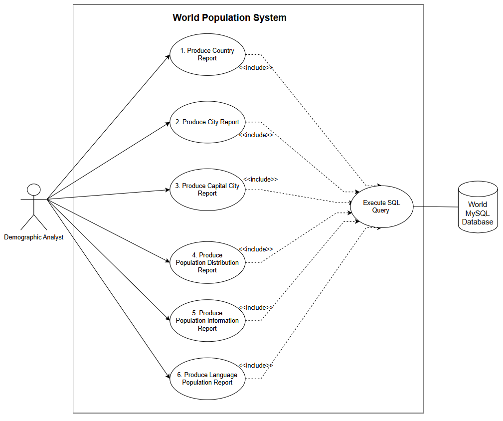

# World Population Reporting System - Description of Use Case Diagram

  

  <strong>Figure 1: World Population Reporting System Use Case Diagram</strong>

---

## Actor

**Demographic Analyst**

The Demographic Analyst uses the World Population Reporting System to produce population reports and retrieve population information. Report parameters, including the target location and the value of N, are predefined in the code. The analyst does not enter parameters during execution.

---

## 1: Produce Country Reports

This group contains requirements 1-6.

### 1.1: Report All Countries in the World by Population

**Requirement:** 1

**User Story:**

As a Demographic Analyst, I want to produce a report of all countries in the world organized by population from largest to smallest so that I can compare population sizes across countries worldwide.

**Description:**

The system produces a report containing all countries in the world, ordered by population from largest to smallest.

**Actor:**

Demographic Analyst

**Preconditions:**

- Country and population data is available.

**Main Flow:**

1. The Demographic Analyst requests the world country population report.
2. The system retrieves population data for all countries.
3. The system sorts the countries by population in descending order.
4. The system displays the report.

**Postcondition:**

- A ranked list of all countries by population is displayed.

---

### 1.2: Report All Countries in a Continent by Population

**Requirement:** 2

**User Story:**

As a Demographic Analyst, I want to produce a report of all countries in a continent organized by population from largest to smallest so that I can analyze population distribution within a specific continent.

**Description:**

The system produces a report containing all countries in a predefined continent, ordered by population from largest to smallest.

**Actor:**

Demographic Analyst

**Preconditions:**

- Country, continent and population data is available.
- The target continent is predefined in the code.

**Main Flow:**

1. The Demographic Analyst requests the continent country population report.
2. The system uses the predefined continent.
3. The system retrieves countries belonging to that continent and their population data.
4. The system sorts the countries by population in descending order.
5. The system displays the report.

**Postcondition:**

- A ranked list of countries in the specified continent is displayed.

---

### 1.3: Report All Countries in a Region by Population

**Requirement:** 3

**User Story:**

As a Demographic Analyst, I want to produce a report of all countries in a region organized by population from largest to smallest so that I can compare population sizes within a specific region.

**Description:**

The system produces a report containing all countries in a predefined region, ordered by population from largest to smallest.

**Actor:**

Demographic Analyst

**Preconditions:**

- Country, region and population data is available.
- The target region is predefined in the code.

**Main Flow:**

1. The Demographic Analyst requests the regional country population report.
2. The system uses the predefined region.
3. The system retrieves countries belonging to that region and their population data.
4. The system sorts the countries by population in descending order.
5. The system displays the report.

**Postcondition:**

- A ranked list of countries in the specified region is displayed.

---

### 1.4: Report Top N Populated Countries in the World

**Requirement:** 4

**User Story:**

As a Demographic Analyst, I want to produce a report of the top N populated countries in the world so that I can identify countries with the largest populations worldwide.

**Description:**

The system produces a report containing the N most populated countries in the world, where N is predefined in the code.

**Actor:**

Demographic Analyst

**Preconditions:**

- Country and population data is available.
- A valid value of N is predefined in the code.

**Main Flow:**

1. The Demographic Analyst requests the top N country population report.
2. The system retrieves population data for all countries.
3. The system sorts the countries by population in descending order.
4. The system selects the top N countries using the predefined value.
5. The system displays the report.

**Postcondition:**

- The top N populated countries worldwide are displayed in descending order of population.

---

### 1.5: Report Top N Populated Countries in a Continent

**Requirement:** 5

**User Story:**

As a Demographic Analyst, I want to produce a report of the top N populated countries in a continent so that I can identify the most populated countries within a specific continent.

**Description:**

The system produces a report containing the N most populated countries in a predefined continent.

**Actor:**

Demographic Analyst

**Preconditions:**

- Country, continent and population data is available.
- The target continent and a valid value of N are predefined in the code.

**Main Flow:**

1. The Demographic Analyst requests the top N country population report for the continent.
2. The system uses the predefined continent and value of N.
3. The system retrieves countries belonging to that continent and their population data.
4. The system sorts the countries by population in descending order.
5. The system selects the top N countries.
6. The system displays the report.

**Postcondition:**

- The top N populated countries in the specified continent are displayed in descending order of population.

---

### 1.6: Report Top N Populated Countries in a Region

**Requirement:** 6

**User Story:**

As a Demographic Analyst, I want to produce a report of the top N populated countries in a region so that I can identify the most populated countries within a specific region.

**Description:**

The system produces a report containing the N most populated countries in a predefined region.

**Actor:**

Demographic Analyst

**Preconditions:**

- Country, region and population data is available.
- The target region and a valid value of N are predefined in the code.

**Main Flow:**

1. The Demographic Analyst requests the top N country population report for the region.
2. The system uses the predefined region and value of N.
3. The system retrieves countries belonging to that region and their population data.
4. The system sorts the countries by population in descending order.
5. The system selects the top N countries.
6. The system displays the report.

**Postcondition:**

- The top N populated countries in the specified region are displayed in descending order of population.

---

## 2: Produce City Reports

This group contains requirements 7-16.

### 2.1: Report All Cities in the World by Population

**Requirement:** 7

**User Story:**

As a Demographic Analyst, I want to produce a report of all cities in the world organized by population from largest to smallest so that I can compare city populations worldwide.

**Description:**

The system produces a report containing all cities in the world, ordered by population from largest to smallest.

**Actor:**

Demographic Analyst

**Preconditions:**

- City and population data is available.

**Main Flow:**

1. The Demographic Analyst requests the world city population report.
2. The system retrieves population data for all cities.
3. The system sorts the cities by population in descending order.
4. The system displays the report.

**Postcondition:**

- A ranked list of all cities worldwide is displayed.

---

### 2.2: Report All Cities in a Continent by Population

**Requirement:** 8

**User Story:**

As a Demographic Analyst, I want to produce a report of all cities in a continent organized by population from largest to smallest so that I can analyze population distribution across cities within a specific continent.

**Description:**

The system produces a report containing all cities in a predefined continent, ordered by population from largest to smallest.

**Actor:**

Demographic Analyst

**Preconditions:**

- City, country, continent and population data is available.
- The target continent is predefined in the code.

**Main Flow:**

1. The Demographic Analyst requests the continent city population report.
2. The system uses the predefined continent.
3. The system retrieves city and country information for that continent.
4. The system identifies the cities belonging to the specified continent.
5. The system sorts the cities by population in descending order.
6. The system displays the report.

**Postcondition:**

- A ranked list of cities in the specified continent is displayed.

---

### 2.3: Report All Cities in a Region by Population

**Requirement:** 9

**User Story:**

As a Demographic Analyst, I want to produce a report of all cities in a region organized by population from largest to smallest so that I can compare city populations within a specific region.

**Description:**

The system produces a report containing all cities in a predefined region, ordered by population from largest to smallest.

**Actor:**

Demographic Analyst

**Preconditions:**

- City, country, region and population data is available.
- The target region is predefined in the code.

**Main Flow:**

1. The Demographic Analyst requests the regional city population report.
2. The system uses the predefined region.
3. The system retrieves city and country information for that region.
4. The system identifies the cities belonging to the specified region.
5. The system sorts the cities by population in descending order.
6. The system displays the report.

**Postcondition:**

- A ranked list of cities in the specified region is displayed.

---

### 2.4: Report All Cities in a Country by Population

**Requirement:** 10

**User Story:**

As a Demographic Analyst, I want to produce a report of all cities in a country organized by population from largest to smallest so that I can analyze population distribution across cities within a specific country.

**Description:**

The system produces a report containing all cities in a predefined country, ordered by population from largest to smallest.

**Actor:**

Demographic Analyst

**Preconditions:**

- City, country and population data is available.
- The target country is predefined in the code.

**Main Flow:**

1. The Demographic Analyst requests the country city population report.
2. The system uses the predefined country.
3. The system retrieves the cities belonging to that country and their population data.
4. The system sorts the cities by population in descending order.
5. The system displays the report.

**Postcondition:**

- A ranked list of cities in the specified country is displayed.

---

### 2.5: Report All Cities in a District by Population

**Requirement:** 11

**User Story:**

As a Demographic Analyst, I want to produce a report of all cities in a district organized by population from largest to smallest so that I can compare population sizes within a specific district.

**Description:**

The system produces a report containing all cities in a predefined district, ordered by population from largest to smallest.

**Actor:**

Demographic Analyst

**Preconditions:**

- City, district and population data is available.
- The target district is predefined in the code.

**Main Flow:**

1. The Demographic Analyst requests the district city population report.
2. The system uses the predefined district.
3. The system retrieves cities belonging to that district and their population data.
4. The system sorts the cities by population in descending order.
5. The system displays the report.

**Postcondition:**

- A ranked list of cities in the specified district is displayed.

---

### 2.6: Report Top N Populated Cities in the World

**Requirement:** 12

**User Story:**

As a Demographic Analyst, I want to produce a report of the top N populated cities in the world so that I can identify cities with the largest populations worldwide.

**Description:**

The system produces a report containing the N most populated cities in the world, where N is predefined in the code.

**Actor:**

Demographic Analyst

**Preconditions:**

- City and population data is available.
- A valid value of N is predefined in the code.

**Main Flow:**

1. The Demographic Analyst requests the top N city population report.
2. The system retrieves population data for all cities.
3. The system sorts the cities by population in descending order.
4. The system selects the top N cities using the predefined value.
5. The system displays the report.

**Postcondition:**

- The top N populated cities worldwide are displayed in descending order of population.

---

### 2.7: Report Top N Populated Cities in a Continent

**Requirement:** 13

**User Story:**

As a Demographic Analyst, I want to produce a report of the top N populated cities in a continent so that I can identify the most populated cities within a specific continent.

**Description:**

The system produces a report containing the N most populated cities in a predefined continent.

**Actor:**

Demographic Analyst

**Preconditions:**

- City, country, continent and population data is available.
- The target continent and a valid value of N are predefined in the code.

**Main Flow:**

1. The Demographic Analyst requests the top N city population report for the continent.
2. The system uses the predefined continent and value of N.
3. The system retrieves city and country information for that continent.
4. The system identifies the cities belonging to the specified continent.
5. The system sorts the cities by population in descending order.
6. The system selects the top N cities.
7. The system displays the report.

**Postcondition:**

- The top N populated cities in the specified continent are displayed in descending order of population.

---

### 2.8: Report Top N Populated Cities in a Region

**Requirement:** 14

**User Story:**

As a Demographic Analyst, I want to produce a report of the top N populated cities in a region so that I can identify the most populated cities within a specific region.

**Description:**

The system produces a report containing the N most populated cities in a predefined region.

**Actor:**

Demographic Analyst

**Preconditions:**

- City, country, region and population data is available.
- The target region and a valid value of N are predefined in the code.

**Main Flow:**

1. The Demographic Analyst requests the top N city population report for the region.
2. The system uses the predefined region and value of N.
3. The system retrieves city and country information for that region.
4. The system identifies the cities belonging to the specified region.
5. The system sorts the cities by population in descending order.
6. The system selects the top N cities.
7. The system displays the report.

**Postcondition:**

- The top N populated cities in the specified region are displayed in descending order of population.

---

### 2.9: Report Top N Populated Cities in a Country

**Requirement:** 15

**User Story:**

As a Demographic Analyst, I want to produce a report of the top N populated cities in a country so that I can identify the most populated cities within a specific country.

**Description:**

The system produces a report containing the N most populated cities in a predefined country.

**Actor:**

Demographic Analyst

**Preconditions:**

- City, country and population data is available.
- The target country and a valid value of N are predefined in the code.

**Main Flow:**

1. The Demographic Analyst requests the top N city population report for the country.
2. The system uses the predefined country and value of N.
3. The system retrieves the cities belonging to that country and their population data.
4. The system sorts the cities by population in descending order.
5. The system selects the top N cities.
6. The system displays the report.

**Postcondition:**

- The top N populated cities in the specified country are displayed in descending order of population.

---

### 2.10: Report Top N Populated Cities in a District

**Requirement:** 16

**User Story:**

As a Demographic Analyst, I want to produce a report of the top N populated cities in a district so that I can identify the most populated cities within a specific district.

**Description:**

The system produces a report containing the N most populated cities in a predefined district.

**Actor:**

Demographic Analyst

**Preconditions:**

- City, district and population data is available.
- The target district and a valid value of N are predefined in the code.

**Main Flow:**

1. The Demographic Analyst requests the top N city population report for the district.
2. The system uses the predefined district and value of N.
3. The system retrieves cities belonging to that district and their population data.
4. The system sorts the cities by population in descending order.
5. The system selects the top N cities.
6. The system displays the report.

**Postcondition:**

- The top N populated cities in the specified district are displayed in descending order of population.

---

## 3: Produce Capital City Reports

This group contains requirements 17-22.

### 3.1: Report All Capital Cities in the World by Population

**Requirement:** 17

**User Story:**

As a Demographic Analyst, I want to produce a report of all capital cities in the world organized by population from largest to smallest so that I can compare capital city populations worldwide.

**Description:**

The system produces a report containing all capital cities worldwide, ordered by population from largest to smallest.

**Actor:**

Demographic Analyst

**Preconditions:**

- Capital city and population data is available.

**Main Flow:**

1. The Demographic Analyst requests the world capital city report.
2. The system identifies all capital cities.
3. The system retrieves their population data.
4. The system sorts the capital cities by population in descending order.
5. The system displays the report.

**Postcondition:**

- A ranked list of capital cities worldwide is displayed.

---

### 3.2: Report All Capital Cities in a Continent by Population

**Requirement:** 18

**User Story:**

As a Demographic Analyst, I want to produce a report of all capital cities in a continent organized by population from largest to smallest so that I can analyze capital city populations within a specific continent.

**Description:**

The system produces a report containing all capital cities in a predefined continent, ordered by population from largest to smallest.

**Actor:**

Demographic Analyst

**Preconditions:**

- Capital city, continent and population data is available.
- The target continent is predefined in the code.

**Main Flow:**

1. The Demographic Analyst requests the continent capital city report.
2. The system uses the predefined continent.
3. The system identifies capital cities belonging to that continent.
4. The system retrieves their population data.
5. The system sorts the capital cities by population in descending order.
6. The system displays the report.

**Postcondition:**

- A ranked list of capital cities in the specified continent is displayed.

---

### 3.3: Report All Capital Cities in a Region by Population

**Requirement:** 19

**User Story:**

As a Demographic Analyst, I want to produce a report of all capital cities in a region organized by population from largest to smallest so that I can compare capital city populations within a specific region.

**Description:**

The system produces a report containing all capital cities in a predefined region, ordered by population from largest to smallest.

**Actor:**

Demographic Analyst

**Preconditions:**

- Capital city, region and population data is available.
- The target region is predefined in the code.

**Main Flow:**

1. The Demographic Analyst requests the regional capital city report.
2. The system uses the predefined region.
3. The system identifies capital cities belonging to that region.
4. The system retrieves their population data.
5. The system sorts the capital cities by population in descending order.
6. The system displays the report.

**Postcondition:**

- A ranked list of capital cities in the specified region is displayed.

---

### 3.4: Report Top N Populated Capital Cities in the World

**Requirement:** 20

**User Story:**

As a Demographic Analyst, I want to produce a report of the top N populated capital cities in the world so that I can identify capital cities with the largest populations worldwide.

**Description:**

The system produces a report containing the N most populated capital cities worldwide, where N is predefined in the code.

**Actor:**

Demographic Analyst

**Preconditions:**

- Capital city and population data is available.
- A valid value of N is predefined in the code.

**Main Flow:**

1. The Demographic Analyst requests the top N capital city population report.
2. The system identifies all capital cities and retrieves their population data.
3. The system sorts the capital cities by population in descending order.
4. The system selects the top N capital cities using the predefined value.
5. The system displays the report.

**Postcondition:**

- The top N populated capital cities worldwide are displayed in descending order of population.

---

### 3.5: Report Top N Populated Capital Cities in a Continent

**Requirement:** 21

**User Story:**

As a Demographic Analyst, I want to produce a report of the top N populated capital cities in a continent so that I can identify the most populated capital cities within a specific continent.

**Description:**

The system produces a report containing the N most populated capital cities in a predefined continent.

**Actor:**

Demographic Analyst

**Preconditions:**

- Capital city, continent and population data is available.
- The target continent and a valid value of N are predefined in the code.

**Main Flow:**

1. The Demographic Analyst requests the top N capital city population report for the continent.
2. The system uses the predefined continent and value of N.
3. The system identifies capital cities belonging to that continent.
4. The system retrieves their population data.
5. The system sorts the capital cities by population in descending order.
6. The system selects the top N capital cities.
7. The system displays the report.

**Postcondition:**

- The top N populated capital cities in the specified continent are displayed in descending order of population.

---

### 3.6: Report Top N Populated Capital Cities in a Region

**Requirement:** 22

**User Story:**

As a Demographic Analyst, I want to produce a report of the top N populated capital cities in a region so that I can identify the most populated capital cities within a specific region.

**Description:**

The system produces a report containing the N most populated capital cities in a predefined region.

**Actor:**

Demographic Analyst

**Preconditions:**

- Capital city, region and population data is available.
- The target region and a valid value of N are predefined in the code.

**Main Flow:**

1. The Demographic Analyst requests the top N capital city population report for the region.
2. The system uses the predefined region and value of N.
3. The system identifies capital cities belonging to that region.
4. The system retrieves their population data.
5. The system sorts the capital cities by population in descending order.
6. The system selects the top N capital cities.
7. The system displays the report.

**Postcondition:**

- The top N populated capital cities in the specified region are displayed in descending order of population.

---

## 4: Produce Population Distribution Reports

This group contains requirements 23-25.

### 4.1: Population Distribution by Continent

**Requirement:** 23

**User Story:**

As a Demographic Analyst, I want to produce a report showing the total population and the population living in and outside cities in each continent, including percentages, so that I can compare urbanization patterns across continents.

**Description:**

The system produces a report showing the total population, population living in cities, population living outside cities and their percentages for each continent.

**Actor:**

Demographic Analyst

**Preconditions:**

- Population and city population data is available.

**Main Flow:**

1. The Demographic Analyst requests the continent population distribution report.
2. The system retrieves population data for each continent.
3. The system calculates the population living in cities.
4. The system calculates the population living outside cities.
5. The system calculates the relevant percentages.
6. The system displays the report.

**Postcondition:**

- Population distribution information for each continent, including totals and percentages, is displayed.

---

### 4.2: Population Distribution by Region

**Requirement:** 24

**User Story:**

As a Demographic Analyst, I want to produce a report showing the total population and the population living in and outside cities in each region, including percentages, so that I can analyze urbanization patterns across regions.

**Description:**

The system produces a report showing the total population, population living in cities, population living outside cities and their percentages for each region.

**Actor:**

Demographic Analyst

**Preconditions:**

- Population and city population data is available.

**Main Flow:**

1. The Demographic Analyst requests the regional population distribution report.
2. The system retrieves population data for each region.
3. The system calculates the population living in cities.
4. The system calculates the population living outside cities.
5. The system calculates the relevant percentages.
6. The system displays the report.

**Postcondition:**

- Population distribution information for each region, including totals and percentages, is displayed.

---

### 4.3: Population Distribution by Country

**Requirement:** 25

**User Story:**

As a Demographic Analyst, I want to produce a report showing the total population and the population living in and outside cities in each country, including percentages, so that I can compare urban and non-urban population distribution across countries.

**Description:**

The system produces a report showing the total population, population living in cities, population living outside cities and their percentages for each country.

**Actor:**

Demographic Analyst

**Preconditions:**

- Population and city population data is available.

**Main Flow:**

1. The Demographic Analyst requests the country population distribution report.
2. The system retrieves population data for each country.
3. The system calculates the population living in cities.
4. The system calculates the population living outside cities.
5. The system calculates the relevant percentages.
6. The system displays the report.

**Postcondition:**

- Population distribution information for each country, including totals and percentages, is displayed.

---

## 5: Produce Population Information Reports

This group contains requirements 26-31.

### 5.1: Produce World Population

**Requirement:** 26

**User Story:**

As a Demographic Analyst, I want to retrieve the total population of the world so that I can use it as a reference for global population analysis.

**Description:**

The system retrieves and displays the total population of the world.

**Actor:**

Demographic Analyst

**Preconditions:**

- World population data is available.

**Main Flow:**

1. The Demographic Analyst requests the total world population.
2. The system retrieves the world population.
3. The system displays the population.

**Postcondition:**

- The total world population is displayed.

---

### 5.2: Produce Population of a Continent

**Requirement:** 27

**User Story:**

As a Demographic Analyst, I want to retrieve the population of a specific continent so that I can analyze its population size.

**Description:**

The system retrieves and displays the population of a predefined continent.

**Actor:**

Demographic Analyst

**Preconditions:**

- Continent population data is available.
- The target continent is predefined in the code.

**Main Flow:**

1. The Demographic Analyst requests the population of the predefined continent.
2. The system retrieves the population of that continent.
3. The system displays the population.

**Postcondition:**

- The population of the specified continent is displayed.

---

### 5.3: Produce Population of a Region

**Requirement:** 28

**User Story:**

As a Demographic Analyst, I want to retrieve the population of a specific region so that I can analyze its population size.

**Description:**

The system retrieves and displays the population of a predefined region.

**Actor:**

Demographic Analyst

**Preconditions:**

- Region population data is available.
- The target region is predefined in the code.

**Main Flow:**

1. The Demographic Analyst requests the population of the predefined region.
2. The system retrieves the population of that region.
3. The system displays the population.

**Postcondition:**

- The population of the specified region is displayed.

---

### 5.4: Produce Population of a Country

**Requirement:** 29

**User Story:**

As a Demographic Analyst, I want to retrieve the population of a specific country so that I can analyze its population size.

**Description:**

The system retrieves and displays the population of a predefined country.

**Actor:**

Demographic Analyst

**Preconditions:**

- Country population data is available.
- The target country is predefined in the code.

**Main Flow:**

1. The Demographic Analyst requests the population of the predefined country.
2. The system retrieves the population of that country.
3. The system displays the population.

**Postcondition:**

- The population of the specified country is displayed.

---

### 5.5: Produce Population of a District

**Requirement:** 30

**User Story:**

As a Demographic Analyst, I want to retrieve the population of a specific district so that I can analyze its population size.

**Description:**

The system retrieves and displays the population of a predefined district.

**Actor:**

Demographic Analyst

**Preconditions:**

- District population data is available.
- The target district is predefined in the code.

**Main Flow:**

1. The Demographic Analyst requests the population of the predefined district.
2. The system retrieves the population of that district.
3. The system displays the population.

**Postcondition:**

- The population of the specified district is displayed.

---

### 5.6: Produce Population of a City

**Requirement:** 31

**User Story:**

As a Demographic Analyst, I want to retrieve the population of a specific city so that I can analyze its population size.

**Description:**

The system retrieves and displays the population of a predefined city.

**Actor:**

Demographic Analyst

**Preconditions:**

- City population data is available.
- The target city is predefined in the code.

**Main Flow:**

1. The Demographic Analyst requests the population of the predefined city.
2. The system retrieves the population of that city.
3. The system displays the population.

**Postcondition:**

- The population of the specified city is displayed.

---

## 6: Produce Language Report

This group contains requirement 32.

### 6.1: Report Population of Selected Languages

**Requirement:** 32

**User Story:**

As a Demographic Analyst, I want to produce a report showing the number of people who speak Chinese, English, Hindi, Spanish and Arabic, organized from largest to smallest and including their percentages of the world population, so that I can compare the global distribution of these languages.

**Description:**

The system produces a report showing the number of people who speak Chinese, English, Hindi, Spanish and Arabic. The languages are organized in descending order by number of speakers, and the percentage of the world population is included.

**Actor:**

Demographic Analyst

**Preconditions:**

- Language speaker data is available.
- World population data is available.
- The five languages are predefined in the code.

**Main Flow:**

1. The Demographic Analyst requests the language population report.
2. The system retrieves the number of speakers for the five predefined languages.
3. The system retrieves the world population.
4. The system calculates the percentage of the world population for each language.
5. The system sorts the languages by number of speakers in descending order.
6. The system displays the report.

**Postcondition:**

- A ranked report of the five languages, including speaker numbers and percentages, is displayed.

---

## Summary

| No. | Description | Requirements |
|---|---|---|
| 1 | Produce Country Reports | 1-6 |
| 2 | Produce City Reports | 7-16 |
| 3 | Produce Capital City Reports | 17-22 |
| 4 | Produce Population Distribution Reports | 23-25 |
| 5 | Produce Population Information Reports | 26-31 |
| 6 | Produce Language Report | 32 |
| | **Total Requirements** | **32** |